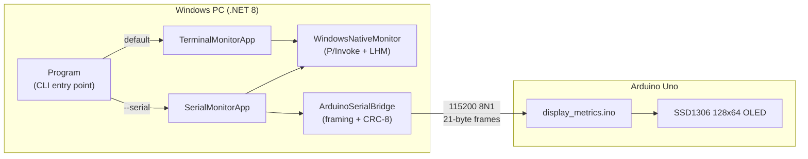

# PC Performance Monitor

[](https://github.com/GuilleMontilla/PC_Performance_Monitor/actions/workflows/ci.yml)


A real-time hardware monitor for Windows, written in C# / .NET 8. It reads CPU, GPU, RAM and network metrics through native Windows APIs (P/Invoke) and [LibreHardwareMonitor](https://github.com/LibreHardwareMonitor/LibreHardwareMonitor), then either prints them to the console or streams them to an **Arduino Uno** that renders them on a **128×64 SSD1306 OLED** — a small external stats screen for your PC.

---

## Table of Contents

- [Features](#features)
- [How It Works](#how-it-works)
- [Requirements](#requirements)
- [Quick Start](#quick-start)
- [Usage](#usage)
- [Arduino Display (Optional)](#arduino-display-optional)
- [Serial Protocol](#serial-protocol)
- [Project Structure](#project-structure)
- [Troubleshooting](#troubleshooting)
- [Documentation](#documentation)
- [Contributing](#contributing)
- [Acknowledgments](#acknowledgments)
- [License](#license)

---

## Features

| Category | Metrics |
|----------|---------|
| **CPU** | Load %, clock (MHz), frequency (MHz), temperature (°C) |
| **GPU** | Load %, clock (MHz), frequency (MHz), temperature (°C), VRAM used / total (MB) |
| **RAM** | Load %, used / total (MB) |
| **Network** | Upload / download throughput (KB/s), summed across all adapters |

- **Terminal mode** — prints a formatted snapshot to the console every second.
- **Serial mode** — packs metrics into a 21-byte binary frame protected by a CRC-8 checksum and streams it to an Arduino at 115200 baud.
- **Arduino auto-detection** — finds the board by USB VID/PID (Arduino Uno, other Arduino boards, CH340 clones) without opening unrelated COM ports.
- **Auto-reconnect** — after 5 consecutive send failures the app re-scans and reconnects.
- **Graceful shutdown** — Ctrl+C releases the sensors and the serial port cleanly.

---

## How It Works



| Component | Responsibility |
|-----------|----------------|
| `Program.cs` | Parses CLI arguments, reports admin privileges, launches the selected mode |
| `WindowsNativeMonitor.cs` | `kernel32.dll` P/Invoke (`GetSystemTimes`, `GlobalMemoryStatusEx`), registry lookup for CPU frequency, LibreHardwareMonitor for temperatures, GPU, VRAM and network |
| `TerminalMonitorApp.cs` | Polls `GetAllMetrics()` and prints the results |
| `SerialMonitorApp.cs` | Polls metrics, forwards them to the bridge, handles reconnects |
| `ArduinoSerialBridge.cs` | WMI port discovery, packs `MetricsPacket`, computes CRC-8, writes to the `SerialPort` |
| `display_metrics.ino` | Validates frames and draws CPU, GPU, RAM and network data on the OLED |

---

## Requirements

| Requirement | Details |
|-------------|---------|
| **OS** | Windows 10 / 11, x64 |
| **.NET SDK** | 8.0 or later — [download](https://dotnet.microsoft.com/download) |
| **Privileges** | Administrator recommended (needed for temperatures and some GPU sensors) |
| **Hardware** *(optional)* | Arduino Uno + SSD1306 128×64 I2C OLED, for serial mode |

---

## Quick Start

```bash
git clone https://github.com/GuilleMontilla/PC_Performance_Monitor.git
cd PC_Performance_Monitor/src/desktop

dotnet restore
dotnet build
dotnet run
```

> Run the terminal **as Administrator** to get CPU/GPU temperatures. Without elevation the app still runs, but some sensors report `0`.

### Release build

```bash
cd src/desktop
dotnet build -c Release
.\bin\Release\net8.0-windows\PCPerformanceMonitor.exe
```

---

## Usage

```
PCPerformanceMonitor.exe [--serial [COMx]] [--verbose]
```

| Option | Description |
|--------|-------------|
| *(none)* | Terminal mode — prints metrics to the console |
| `--serial`, `--arduino` | Serial mode — auto-detects the Arduino and streams frames to it |
| `--serial COMx` | Serial mode on an explicit port (skips auto-detection) |
| `--verbose`, `-v` | In serial mode, also echo each frame's metrics to the console |

### Examples

```bash
# Live console output
PCPerformanceMonitor.exe

# Stream to an auto-detected Arduino
PCPerformanceMonitor.exe --serial

# Explicit port, with console echo
PCPerformanceMonitor.exe --serial COM5 --verbose

# Same thing via the SDK
dotnet run -- --serial COM5 --verbose
```

Sample terminal output:

```
=== System Metrics - 2026-10-28 18:30:12 ===
CPU: Load: 12.4% | Clock: 4520MHz | Freq: 3600MHz | Temp: 48.0°C
GPU: Load: 3.0% | Clock: 210MHz | Freq: 210MHz | Temp: 41.0°C
VRAM: 1024MB / 8192MB
RAM: Load: 41.2% | Used: 13190MB / 32012MB
NET: Upload: 12.3 KB/s | Download: 245.8 KB/s
```

Press **Ctrl+C** to stop.

---

## Arduino Display (Optional)

### Wiring (I2C)

| SSD1306 | Arduino Uno |
|---------|-------------|
| SDA | A4 |
| SCL | A5 |
| VCC | 5V |
| GND | GND |

### Flashing the firmware

1. Open [`src/firmware/display_metrics/display_metrics.ino`](src/firmware/display_metrics/display_metrics.ino) in the Arduino IDE.
2. Install **Adafruit SSD1306** and **Adafruit GFX Library** from the Library Manager.
3. Select the **Arduino Uno** board and upload.
4. Run the desktop app with `--serial`.

The OLED shows *"Waiting for PC..."* until the first valid frame arrives, and again if no frame is received for 5 seconds.

More detail: [wiring guide](docs/arduino-wiring.md), [circuit diagram](docs/diagrams/circuit.md), [Fritzing / PDF assets](docs/diagrams/hardware/).

---

## Serial Protocol

Each second the PC sends a **21-byte little-endian frame** at **115200 baud, 8N1**:

| Offset | Size | Field | Description |
|--------|------|-------|-------------|
| 0 | 1 | `Header1` | `0xAA` |
| 1 | 1 | `Header2` | `0x55` |
| 2 | 1 | `CpuLoad` | CPU load, 0–100 % |
| 3 | 1 | `CpuTemp` | CPU temperature, °C |
| 4 | 1 | `GpuLoad` | GPU load, 0–100 % |
| 5 | 1 | `GpuTemp` | GPU temperature, °C |
| 6 | 2 | `RamUsed` | RAM used, MB |
| 8 | 2 | `RamFree` | RAM free, MB |
| 10 | 2 | `RamTotal` | RAM total, MB |
| 12 | 4 | `NetUpload` | Upload, KB/s |
| 16 | 4 | `NetDownload` | Download, KB/s |
| 20 | 1 | `Checksum` | CRC-8 Dallas/Maxim of bytes 2–19 |

The firmware drops any frame whose header or checksum doesn't match. The PC app and the sketch must agree on baud rate and checksum, so **re-flash the Arduino whenever the protocol changes**. Full spec, including the auto-detection order: [docs/serial-protocol.md](docs/serial-protocol.md).

---

## Project Structure

```
PC Performance Monitor/
├── src/
│   ├── desktop/                  # .NET 8 Windows app
│   │   ├── PCPerformanceMonitor.csproj
│   │   ├── Program.cs
│   │   ├── WindowsNativeMonitor.cs
│   │   ├── TerminalMonitorApp.cs
│   │   ├── SerialMonitorApp.cs
│   │   └── ArduinoSerialBridge.cs
│   └── firmware/                 # Arduino Uno sketch
│       └── display_metrics/
│           └── display_metrics.ino
├── docs/                         # Protocol, wiring, diagrams
│   ├── serial-protocol.md
│   ├── arduino-wiring.md
│   └── diagrams/
├── .github/                      # CI workflow, issue and PR templates
├── CONTRIBUTING.md
├── LICENSE
└── README.md
```

### Dependencies

| Package | Version | Purpose |
|---------|---------|---------|
| [LibreHardwareMonitorLib](https://www.nuget.org/packages/LibreHardwareMonitorLib/) | 0.9.3 | Temperatures, clocks, GPU load, VRAM, network throughput |
| [System.IO.Ports](https://www.nuget.org/packages/System.IO.Ports/) | 8.x | Serial communication |
| [System.Management](https://www.nuget.org/packages/System.Management/) | 8.x | WMI queries for Arduino port detection |

---

## Troubleshooting

| Problem | Fix |
|---------|-----|
| CPU/GPU temperatures show `0` | Run as **Administrator**; LibreHardwareMonitor needs elevation to read most sensors |
| GPU not detected | Update GPU drivers. LibreHardwareMonitor supports NVIDIA, AMD and Intel GPUs |
| `dotnet restore` / build fails | Check the SDK with `dotnet --version` (8.0+ required). The project targets `net8.0-windows` / x64 |
| "No Arduino-like COM port found" | Check the USB cable and drivers, then list ports with `[System.IO.Ports.SerialPort]::GetPortNames()` in PowerShell and pass one explicitly: `--serial COMx` |
| OLED stuck on *"Waiting for PC..."* | Re-upload the current sketch — older firmware used 9600 baud and an XOR checksum, which the current app does not speak |
| Repeated "Send failed" messages | The app reconnects after 5 failures. Close other programs holding the port (e.g. the Arduino IDE Serial Monitor) |

---

## Documentation

- [Documentation index](docs/README.md)
- [Serial protocol](docs/serial-protocol.md)
- [Arduino wiring](docs/arduino-wiring.md)
- [System overview & module flow diagrams](docs/diagrams/overview.md)

---

## Contributing

Contributions are welcome. Read [CONTRIBUTING.md](CONTRIBUTING.md) for setup, branch naming, Conventional Commits and the PR checklist. Bug reports and feature requests can be filed through the issue templates.

---

## Acknowledgments

- [LibreHardwareMonitor](https://github.com/LibreHardwareMonitor/LibreHardwareMonitor) (MPL-2.0) for hardware sensor access.
- [Adafruit SSD1306](https://github.com/adafruit/Adafruit_SSD1306) and [Adafruit GFX](https://github.com/adafruit/Adafruit-GFX-Library) for the OLED driver.

---

## Author

**Guillermo A. Montilla Ramos** — guillermomontilla111@outlook.com

## License

Released under the [MIT License](LICENSE).
