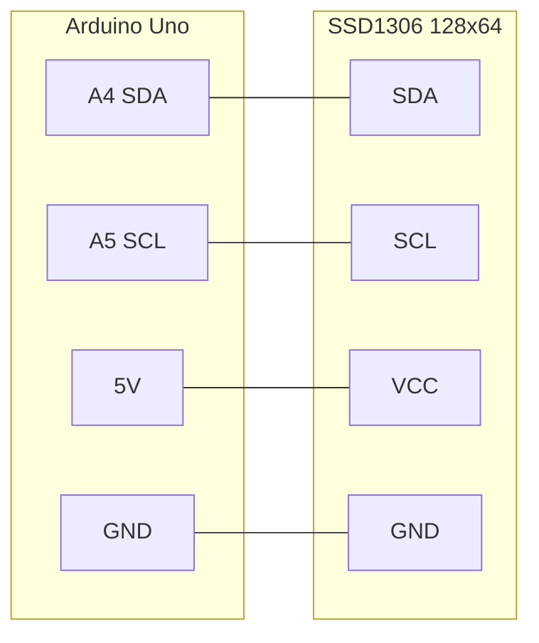

# Circuit: Arduino Uno + SSD1306 OLED

I2C wiring for the project target board (**Arduino Uno**, VID `0x2341`, PID `0x0043`).

| OLED pin | Uno pin |
|----------|---------|
| SDA | A4 |
| SCL | A5 |
| VCC | 5V |
| GND | GND |

Libraries: Adafruit SSD1306 + Adafruit GFX.

See also [arduino-wiring.md](../arduino-wiring.md) and [hardware assets](hardware/).
