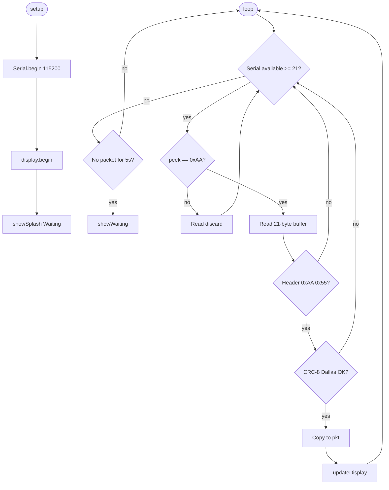

# Flow: display_metrics.ino

Firmware on Arduino Uno — parse frames and drive SSD1306.

Source: [`src/firmware/display_metrics/display_metrics.ino`](../../../src/firmware/display_metrics/display_metrics.ino)
