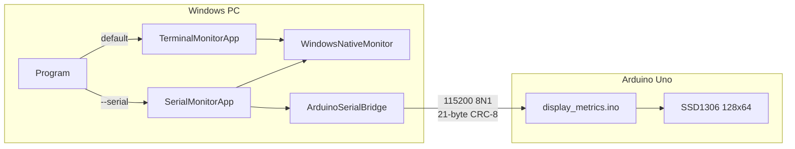

# System overview

End-to-end data path: Windows metrics → optional serial → Arduino OLED.

## Module flows

- [Program](flows/program.md)
- [WindowsNativeMonitor](flows/windows-native-monitor.md)
- [TerminalMonitorApp](flows/terminal-monitor-app.md)
- [SerialMonitorApp](flows/serial-monitor-app.md)
- [ArduinoSerialBridge](flows/arduino-serial-bridge.md)
- [Firmware display_metrics](flows/display-metrics-firmware.md)
- [Circuit wiring](circuit.md)
